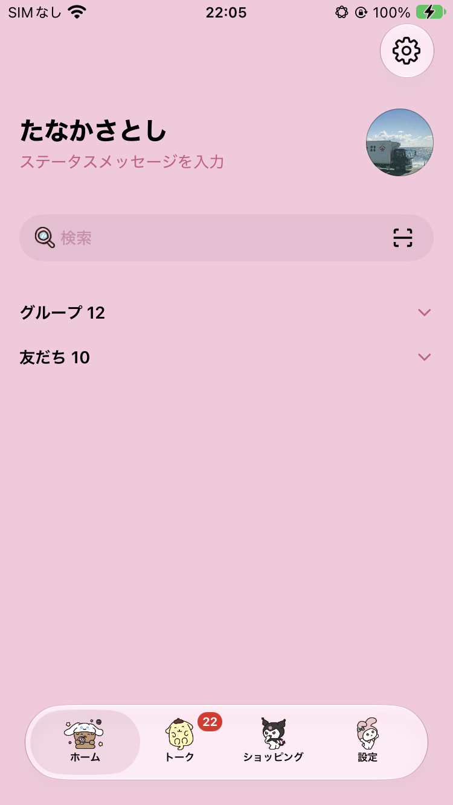
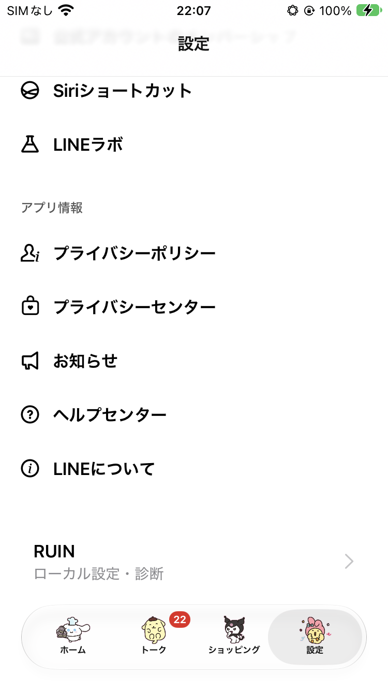
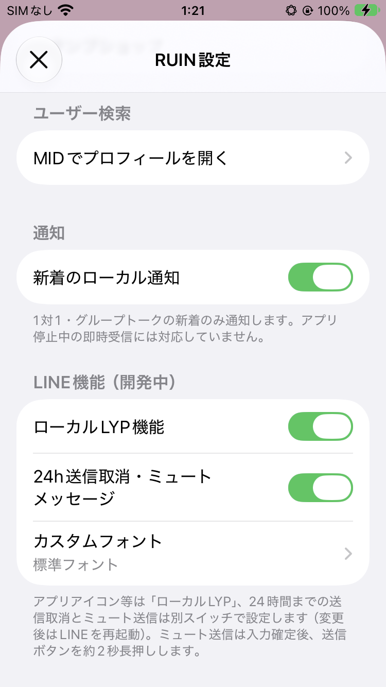

# RUIN

iOS 版 LINE 向けの非公式機能拡張（Tweak）です。  
既読回避、送信取消メッセージの保持、ミュート送信、季節・トークエフェクト、タブや表示のカスタマイズ、着せかえ・カスタムフォント適用などの機能を提供します。

> [!NOTE]
> 本プロジェクトは非公式の拡張機能であり、LINEヤフー株式会社およびその関連会社とは一切関係がありません。利用は自己責任でお願いします。

---

## 対応環境

| 項目 | 内容 |
| :--- | :--- |
| **対応 LINE バージョン** | **26.17.0**（Build `2026.1103.1841`）のみ |
| **対応 OS** | iOS 18.0 以降 |
| **アーキテクチャ** | `arm64` / `arm64e` |
| **利用可能な環境** | **LiveContainer** / **Sideload**（無料 Apple ID・有料購入証明書の両方に対応） / **Jailbreak**（Rootless・Rootful） |

### テスト済み実機

以下の実機環境で動作テストを行っています。

- **iPhone SE（第2世代）** — iOS 27 / LiveContainer / 有料証明書署名（ESign, GBox）
- **iPad（第8世代）** — iOS 18.2.1 / Dopamine（Rootless Jailbreak）

---

## スクリーンショット

| ホーム画面 | LINE 設定内の入口 | RUIN 設定 |
| :---: | :---: | :---: |
|  |  |  |
